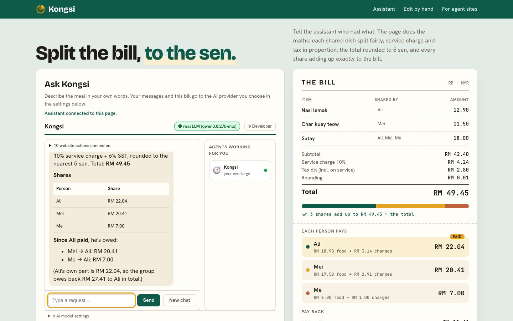

# Kongsi - split the bill, to the sen

Kongsi ("share" in Malay) is an **open agentic website** for splitting a shared restaurant bill.
You tell its assistant who had what, in your own words. The assistant puts it on the bill by
calling the page's own functions, and the page - not the language model - works out every
share: shared dishes split equally, service charge and tax in proportion, the total rounded to
5 sen (Malaysian cash rounding), and the shares always adding up exactly to the total.

Other agent sites can hand a bill to Kongsi too: its agent network is public data, and its
action bridge shares a read-only `calculate_split` tool that runs Kongsi's own code on Kongsi's
origin.



## Why

Splitting a bill is everyday arithmetic that people get wrong and language models get wrong
more often: rounding drifts, service charge is applied to the wrong base, shares do not add up.
Kongsi uses the agent for what it is good at - turning "Mei and I shared the satay" into
structured items - and keeps the money maths in ordinary, tested code.

## How it follows the open agentic web spec

Built on the [Minimum Viable Specification for a Worldwide Agentic Web](https://github.com/cognizant-ai-labs/agentic-web/blob/main/docs/worldwide_agentic_web_mvp_spec.md)
(MVP Profile 0.2).

| Spec item | In Kongsi |
|---|---|
| Portable network (Neuro SAN HOCON, published as resolved JSON) | `kongsi_bill_splitter.hocon` → `kongsi_bill_splitter.network.json` |
| Site manifest | `agent-manifest.json` (network, front agent, router, closed peer policy, actions) |
| Peer link map | `links.json` |
| Browser runtime | `runtime/` - the nsdeploy browser runtime (Apache-2.0) as patched by the agentic-web `agentify-website` skill, unchanged |
| Interface for people | the chat on `index.html`, next to the live bill |
| LLM and key settings (BYOK) | **AI model settings** under the chat: any OpenAI-compatible provider, Connect with Otari / OpenRouter, or a local model |
| Grounded site actions | `site-actions.js`: 10 `website_*` tools (read, write, irreversible) wrapping `js/bill-store.js` |
| User-owned writes | `clear_bill` is irreversible: `site.js` shows the site's own confirmation dialog with what will be cleared |
| Callable by other agent sites | `bridge/` + `bridge/bridge-actions.js` share `calculate_split` (read only, `callerOrigins: ["*"]`) |
| Discovery files | `agent-mcp.json`, `.well-known/nsdeploy.json`, `.well-known/nsdeploy-agent.json` |
| Public files with CORS | `_headers` (Netlify / Cloudflare Pages) and `scripts/serve.mjs` |

Network URL once hosted: `https://<your-host>/kongsi_bill_splitter`.

## Run it locally

Needs Node.js 22 or newer. No dependencies, no build step.

```shell
node scripts/serve.mjs --port 8471
```

Open http://127.0.0.1:8471/. Press **Set up the AI model** (or expand **AI model settings** under the chat) and either
paste a key for a provider that allows browser calls (hosted Otari is the default; OpenAI,
OpenRouter, Groq and Google AI Studio are listed), use **Connect with Otari / OpenRouter**, or
run a local model:

- Ollama: open **Advanced settings**, set Provider URL `http://127.0.0.1:11434/v1`, Model
  `qwen3.8:27b-mlx` (or any tool-calling model you have), and any text such as `ollama` as the
  key. Ollama allows calls from `127.0.0.1` and `localhost` pages by default.

Then click **Try the example meal** on the bill and press Enter in the chat.

Your messages and the bill go to the AI provider you choose. Keys stay in this browser's
storage for this site (on `localhost`/`127.0.0.1` the runtime also mirrors them into a local
cookie). When you are done, choose **Delete setup** in the settings and close the tab.

## Tests

```shell
node --test "tests/*.test.mjs"
```

28 tests: the bill maths against hand-worked amounts (5-sen rounding, largest-remainder
allocation, 500 random bills that must add up exactly), and the agent integration with the real
runtime and a scripted model (network validity, every action through `dispatchToolCall`,
refusals change nothing, the confirmation dialog, the bridge sharing only the calculator).

To rebuild the network JSON after editing the `.hocon`, use the build script from the
[agentic-web repository](https://github.com/cognizant-ai-labs/agentic-web):

```shell
SKILL_DIR=<path to agentic-web>/skills/agentify-website
node "$SKILL_DIR/scripts/build_network.mjs" kongsi_bill_splitter.hocon --manifest agent-manifest.json --check
node "$SKILL_DIR/scripts/check_partner.mjs" http://127.0.0.1:8471/kongsi_bill_splitter
```

## What the assistant can do

| Tool | Effect | What it does |
|---|---|---|
| `get_bill` | read | People, items with ids, charges, totals, shares, who owes the payer, version |
| `add_people` | write | Adds people by name |
| `remove_person` | write | Removes a person; refused while they are the only one sharing an item |
| `add_items` | write | Adds several items at once; sharers not yet on the bill are added |
| `update_item` / `remove_item` | write | Corrects or removes one item |
| `set_charges` | write | Service %, tax %, tax on service or not, discount, rounding |
| `set_payer` | write | Who paid the whole bill |
| `calculate_split` | read | What-if split of a bill given in full; changes nothing (also shared with other sites) |
| `clear_bill` | irreversible | Starts over, after the visitor confirms in the site's dialog |

It declines what the site cannot do - payments (DuitNow, transfers), messaging, receipt photos,
currency conversion - and points to the page's **Copy summary** button instead.

## Calling Kongsi from another agent site

Add Kongsi's network URL to an agent's `tools`, its origin to `allowed_peers`, and a
`link_labels` entry. After the visitor agrees on the consent card, Kongsi's network runs in the
caller's browser on the caller's model and key, with only the `calculate_split` tool from
Kongsi's bridge. Ask with seats or initials, never personal names, for example:
`Split: S1 nasi lemak 14.90; S2 mee 10.50; all share satay 18. 10% svc, 6% tax, round 5 sen.`

`examples/caller/` is a small example caller page (a dinner receipt) wired this way for local
testing. In a local run its assistant showed the consent card, nothing reached Kongsi before
**Allow**, then Kongsi's network ran in the caller's page, called `calculate_split` through
Kongsi's bridge and returned exact shares per seat:

```shell
node scripts/serve.mjs --port 8471          # Kongsi on 127.0.0.1
node scripts/serve.mjs --port 8472          # then open http://localhost:8472/examples/caller/
```

Use the two different host names so the runtime's local key cookie is not shared. Before
hosting the example, replace `http://127.0.0.1:8471` in its `.hocon`, `agent-manifest.json`
and `site-actions.js` with Kongsi's https URL and rebuild it.

## Files

```text
index.html, styles.css, favicon.svg   the page
js/split-core.js                      bill maths (pure functions)
js/bill-store.js                      the bill and every operation on it
js/calculate-action.js                calculate_split, shared by the page and the bridge
js/app.js                             page view and forms
site-actions.js                       website_* tools for the agent
site.js                               boots the runtime, confirmation dialog
kongsi_bill_splitter.hocon            network source
kongsi_bill_splitter.network.json     published network (generated)
agent-manifest.json, links.json       public agent files
agent-mcp.json, .well-known/          discovery files (generated)
bridge/                               action bridge for other agent sites
runtime/                              browser agent runtime (Apache-2.0, unchanged)
examples/caller/                      example caller site
scripts/serve.mjs, _headers           local server and static-host headers
tests/                                node --test suites
DESIGN.md                             visual design and motion notes
```

## Known limits

- Static site: the bill lives in this browser only (localStorage). No accounts, no sharing links.
- A visitor needs their own AI provider (key, OAuth connect, or a local model); there is no
  site-paid default router.
- The model must make tool calls reliably. With the small local `qwen3.5` the bill was filled
  correctly, but about half the turns ended without a closing message, and one turn put every
  dish on everyone. `qwen3.8:27b` did the full flow, including the cross-site call, in about a
  minute per turn.
- The model is told never to compute money, but a model can still add numbers in its own
  wording (one reply added two amounts owed into a total). The bill on the page is the source
  of truth.
- `write` tools run without a dialog (only `clear_bill` asks), as in the reference runtime.
- Amounts are Ringgit only; one item cannot be split unevenly (add it as two items).
- Cross-site calls are bounded by the runtime: 90 s and 24 agent calls per visitor message.

## Licence

Apache-2.0 (see `LICENSE`). `runtime/` is the nsdeploy browser runtime, Apache-2.0, with its
own `runtime/LICENSE.txt` and `runtime/README.md`. Fonts: Bricolage Grotesque, Hanken Grotesk
and JetBrains Mono (SIL Open Font License), loaded from Google Fonts.
